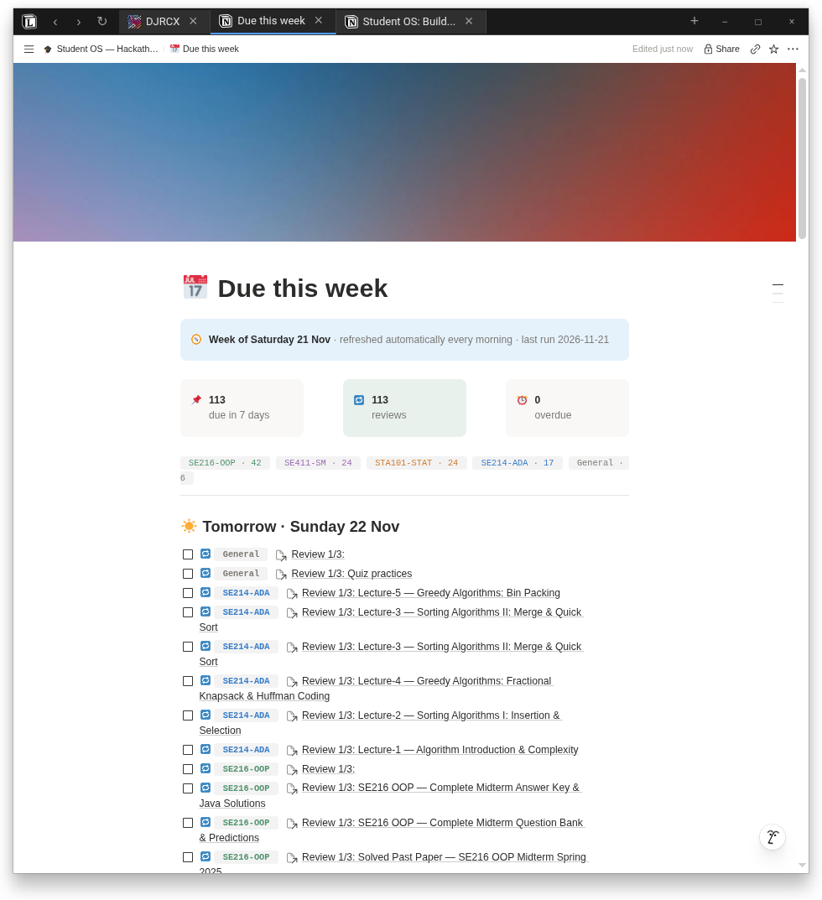
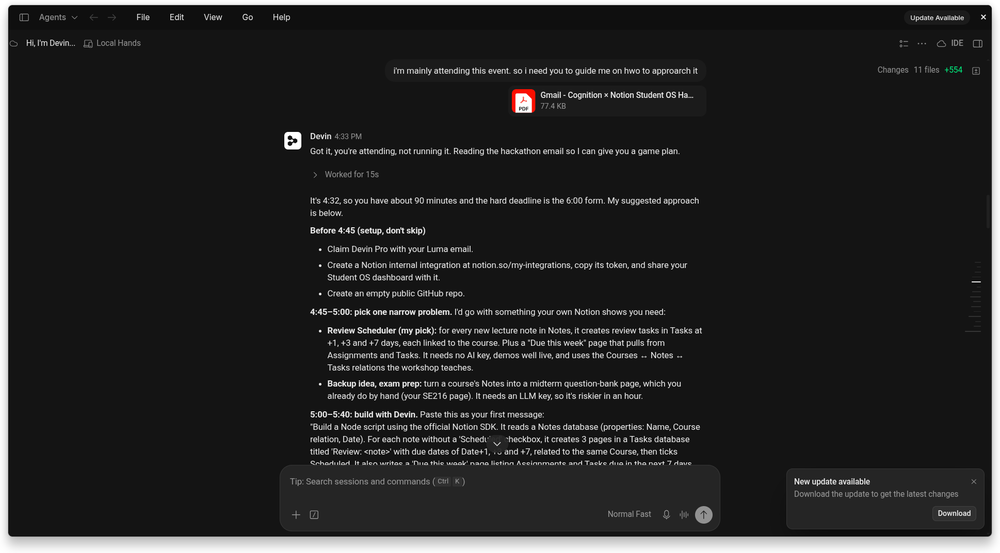
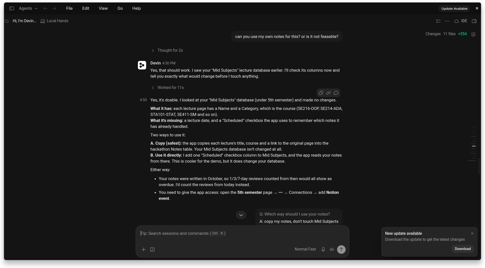
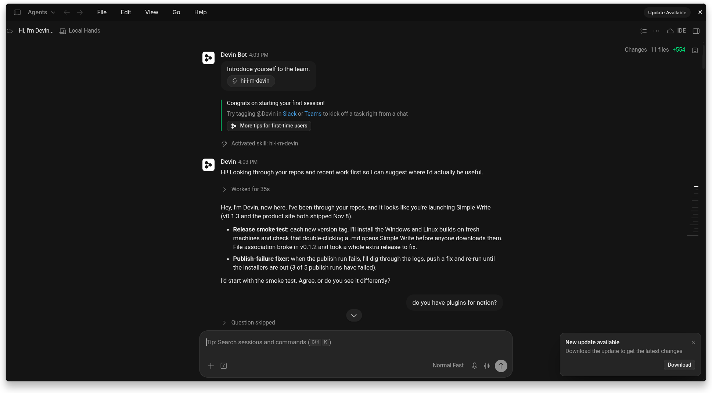

# Student OS Review Scheduler

Turns the lecture notes you already keep in Notion into a spaced-repetition review plan and a daily-refreshed "Due this week" page, built on **Notion Student OS**.

> **Runs on my real notes.** It reads the 37 lecture notes from my own 5th-semester "Mid Subjects" database (SE216 OOP, SE214 Algorithms, SE411 Project Management, STA101 Statistics). There's no fake data, and my original database is never modified.

**🔗 Live Notion page (public):** [My OS](https://www.notion.so/My-OS-41f4dd44fa4a81edaf0ee83943ff34d5): the dashboard, the review tasks, my notes and the auto-generated "📅 Due this week" page.



## The problem

Students take lecture notes and then never look at them again until the night before the exam. Deadlines are spread across courses, so it's easy to miss a quiz while studying for another subject.

## What it does

1. **Import your notes** (`npm run import`): copies every page from your existing notes database into the Student OS **Notes** table. It maps your course tag (e.g. `SE216-OOP`) to a **Course** and keeps a link back to the original page. Your database is only read, never changed, and re-running only picks up new notes.
2. **Schedule reviews** (`npm run schedule`): for every new note, it creates 3 review tasks in **Tasks** at +1, +3 and +7 days (configurable). Each task is linked to the course and to the note. The note is then marked `Scheduled` so it's never processed twice.
3. **Weekly digest** (`npm run digest`): builds a `📅 Due this week` page listing assignments and review tasks due in the next 7 days, grouped by day, with overdue items in red and an exam callout.
4. **Runs by itself every morning** on GitHub Actions (see below).

## How it uses Notion Student OS

It's built on the Student OS data model from the workshop:

| Database | Key properties | Relations |
|---|---|---|
| Courses | Name, Code, Faculty, Exam Date | |
| Assignments | Name, Due, Type, Status | → Course |
| Notes | Name, Date, Scheduled, Source | → Course |
| Tasks | Name, Due, Done | → Course, → Source Note |

Everything runs through the official Notion REST API (`api.notion.com/v1`) using an internal connection. There are no dependencies, only Node's built-in `fetch`.

## How Devin was used

Devin (via Devin Chat) did the following:

1. Read the hackathon brief and helped pick a problem small enough for a one-hour build.
2. Connected to my Notion workspace through the Notion MCP and found my existing "Mid Subjects" lecture database.
3. Wrote all the code on my laptop through a local-machine connection: the API helper, setup, import, scheduler, digest and GitHub workflow.
4. Ran it against my real workspace, imported my notes, set up the daily GitHub Actions run with encrypted secrets, and wrote this README.

### Screenshots from the Devin Chat session

**Planning the hackathon approach from the event email:**



**Switching from sample data to my own Mid Subjects notes:**



**Starting the session:**



## Use it with your own notes

You need Node.js 20.6+ and a Notion database of notes. Any database works, as long as each page has a title. A select column holding the course code (like `SE216-OOP` or `CSE101`) is optional but gives you course grouping.

1. **Get the code**
   ```bash
   git clone https://github.com/DJRCX/student-os-review-scheduler.git
   cd student-os-review-scheduler
   cp .env.example .env
   ```
2. **Create a Notion connection:** go to https://www.notion.so/profile/integrations → **New connection** → Internal. Copy the secret into `.env` as `NOTION_TOKEN`.
3. **Make a home page:** create an empty Notion page (e.g. "Study Planner"). Open ••• → Connections and add your connection. Copy the page ID (the 32 characters at the end of its URL) into `.env` as `NOTION_PARENT_PAGE_ID`.
4. **Point it at your notes:** on the page that contains your notes database, open ••• → Connections and add the same connection. Open the database as a full page and copy its ID from the URL into `.env` as `NOTION_SOURCE_DB`. If your course column isn't called `Category`, set `SOURCE_COURSE_PROPERTY=YourColumnName`.
5. **Run it**
   ```bash
   npm run setup -- --no-sample   # creates Courses/Assignments/Notes/Tasks on your page (run once)
   npm run import                 # copies your notes in
   npm start                      # creates review tasks + the "Due this week" page
   ```
   Want to try it without your own notes first? Run `npm run setup` (without `--no-sample`) to get demo data, then skip `import`.
6. **Optional:** add your real deadlines to **Assignments** so they show up in the digest next to your reviews.

## Runs automatically every day

`.github/workflows/daily.yml` runs on GitHub's servers every day at 01:00 UTC (07:00 in Dhaka):

1. GitHub starts a fresh Linux machine and checks out this repo.
2. It installs Node 22.
3. It runs `npm run import`, so new pages in your notes database get copied in.
4. It runs `npm start`, so new notes get +1/+3/+7 review tasks and `📅 Due this week` is rebuilt.

The machine reads your token and table IDs from **encrypted repository secrets**, so they never appear in the code or logs.

To enable it on your fork:
```bash
gh secret set -f .env   # uploads every value from .env as a secret
```
Then go to **Actions** → **Daily review scheduler** → **Run workflow** to test it once. After that it runs every morning. Change the `cron` line to pick a different time.

## Configuration

| Variable | Required | Meaning |
|---|---|---|
| `NOTION_TOKEN` | yes | Internal connection secret |
| `NOTION_PARENT_PAGE_ID` | yes | Page where the tables and digest live |
| `NOTION_SOURCE_DB` | for import | Your own notes database |
| `SOURCE_COURSE_PROPERTY` | no | Select column holding the course code (default `Category`) |
| `REVIEW_INTERVALS` | no | Days between reviews (default `1,3,7`) |
| `NOTION_*_DB` | auto | Written to `.env` by `npm run setup` |
